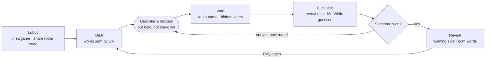

# A3 Spy — PRD: gameplay revamp

Owner: Khoi Do · Last updated: 2026-10-13 · Status: MVP shipped

A3 Spy is a Telegram bot that acts as the game master for *Who is Spy* while a group of friends plays together at a café. People describe and argue out loud; the bot deals secret words, calls the speaking order, runs the vote, eliminates players, reveals the cards and keeps score.

The rules the code implements live in [`docs/rules.md`](../../../docs/rules.md). When this PRD and the rules disagree, this PRD wins and the rules are fixed in the same PR.

## 1. Context and problem

The legacy bot only dealt words. Someone still had to run the game by hand, and that person never got to play properly.

- **It dealt roles but did not run the game.** There were no speaking turns, no vote, no elimination and no win check, so the table had to remember who was out.
- **The rules were too thin.** There was always exactly one spy and the spy had no word, so with 5+ players the spy was found almost immediately.
- **It was clumsy.** Players picked a room from a reply keyboard and typed a command for every step, which breaks the flow at a café table.
- **Anyone could break a game.** `/reset` wiped every room and `/config` replaced everyone's word list.
- **It was unreliable.** The bot ran on a laptop with state in memory, so a restart lost every room, and nobody knew whether it was online.

## 2. Goals, non-goals and principles

**Goal:** everyone at the table, including whoever used to run the game, gets to play. The first game starts within a minute of sitting down, and the table can play game after game without setting up again.

### Goals

1. The bot fully replaces the game master: dealing, speaking order, vote, count, elimination, win/loss.
2. Full Who is Spy rules (civilian / spy / Mr. White), balanced automatically by player count.
3. Every in-game action is a button tap, not a typed command.
4. The bot is online 24/7 and depends on nobody's machine.

### Non-goals

- Remote play: no describing through the bot, no voice. Describing and discussion happen out loud.
- Public release, onboarding for strangers, monetisation.
- A separate app or website at this stage.

### Product principles

- **Eyes on each other, not on the screen.** Phones come out only to read the word, vote and see results, with at most 1–2 taps each time.
- **DM only, no group chat.** Every player chats privately with the bot and joins a room by code or invite link. Shared announcements go to every player's DM; words go only to their owner.
- **Nobody gets stuck.** If the host leaves, someone else takes over; if someone does not vote, the game still moves on.
- **The bot does not set the pace.** No timers by default; the host moves the game to the next phase when the table is ready. Timers are optional.

## 3. Users and context

Typical setting: 5–10 people around a café table, each with Telegram on their phone, on patchy 4G or café Wi-Fi, playing 3–8 games over 1–2 hours. The whole group is under 30 people, and two tables may play at once.

| Persona | Who | Needs from the bot |
|---|---|---|
| Host | Whoever organised the meet-up and sets the pace | Open a room fast, advance phases, still play like everyone else |
| Player | A friend who knows the game | One tap to join, see their secret word, vote fast, see the result |
| Newcomer | A friend of a friend, first time | Understand the rules in 30 seconds; install nothing beyond Telegram |
| Latecomer | Arrives mid-game | Wait for the next game without breaking the current one |

## 4. Rules

The rules follow the *Undercover* variant: civilians and spies each get a word, the two words are similar, and **spies are not told they are spies**. This is the biggest change from the legacy bot: a spy has to work out from other people's descriptions that they are off, which makes games longer and more fun.

### Roles

| Role | Receives | Knows their role? | Wins when |
|---|---|---|---|
| Civilian | Word A (e.g. *Trà sữa*) | No | Every spy and Mr. White is eliminated |
| Spy | Similar word B (e.g. *Cà phê sữa*) | No | Civilians alive ≤ spies + Mr. White alive |
| Mr. White (optional) | No word | Yes | With the spies; or alone, by guessing word A correctly after being eliminated |

### Default role counts

The host may adjust these before starting (see L4).

| Players | Spies | Mr. White |
|---|---|---|
| 3–4 | 1 | 0 |
| 5–6 | 1 | 1 |
| 7–9 | 2 | 1 |
| 10–12 | 3 | 1 |

The bot refuses to start with fewer than 3 players. Above 12 it suggests splitting into two tables, but still allows the game.

### A game is a series of rounds

1. **Describe.** The bot announces the speaking order. Each living player says one word or sentence about their word, out loud. Mr. White never speaks first.
2. **Discuss.** Free talk; the bot stays out of it.
3. **Vote.** Each living player taps one other player. Votes stay hidden until the vote closes.
4. **Eliminate.** The player with the most votes is out and the bot reveals their role.
   - On a tie, the tied players face a revote.
   - If the revote ties again, nobody is eliminated and a new round starts.
5. **Mr. White's guess.** If Mr. White is eliminated, they get one typed guess at the civilians' word. Case and extra spaces are ignored; Vietnamese diacritics must match.
6. **Win check.** If nobody has won yet, the next round starts.

Eliminated players stay at the table and listen, but no longer describe or vote. When the game ends, the bot reveals everything: who had which role and both words.

### Decisions taken during the MVP

- From round 2 onwards, the speaking order is the previous order rotated by one (eliminated players removed) instead of a fresh shuffle, so a different person opens each round.
- A player who leaves mid-game counts as eliminated and their role is revealed. Mr. White leaving instead of guessing counts as a wrong guess.
- If nobody votes, nobody is eliminated and a new round starts.

## 5. Flow of a game

The describe → vote → eliminate loop repeats until one side wins. *Play again* goes back to dealing with a new word pair and the same players.

## 6. User stories

The MVP is every **Must** story: enough to play a whole café session without anyone running the game by hand. There is no group chat; every player chats with the bot privately, joins by code or link, the bot sends shared announcements to everyone's DM, and every action is an inline button.

Each story is a GitHub issue with full acceptance criteria.

| ID | Story | Acceptance criteria (summary) | Priority | Status |
|---|---|---|---|---|
| **Rooms** | | | | |
| L1 | As a host, I type `/newgame` in a DM with the bot to open a room | 4-character room code and invite link `t.me/<bot>?start=<code>`; host joins automatically; one room per player at a time | Must | Done (#2) |
| L2 | As a player, I tap the invite link or type `/join <code>` to join | No room list to pick from; tapping again does not add me twice; correct display name (never "None"); the room is told "X joined" | Must | Done (#3) |
| L3 | As someone in a room, I see who is there | Each player has a lobby message in their DM, updated in place; a [Leave room] button; the host also has [Start] | Must | Done (#4) |
| L4 | As a host, I set the word packs, the number of spies and Mr. White on/off before starting | Defaults follow the role table; config buttons only in the host's DM | Should | Open (#5) |
| L5 | As a latecomer, I go to a waiting list while a game is running | I get no word for the current game; I am dealt into the next one | Should | Done (#6) |
| **Dealing** | | | | |
| R1 | As a player, I get my word without the person next to me seeing it | DM "Your word: X", the same template for civilians and spies; Mr. White gets "You are Mr. White" | Must | Done (#7) |
| R2 | As a player, I can see my word again without scrolling | The game status message has a [Show my word] button that opens a popup | Should | Done (#8) |
| **Rounds** | | | | |
| G1 | As a player, I know who speaks first | At the start of each round the bot sends the whole room the speaking order (living players only); Mr. White is never first | Must | Done (#9) |
| G2 | As a host, I tap [Open vote] when the table has finished talking | Each living player gets name buttons in their DM; one vote, changeable until close; the host sees "Voted 5/7" without seeing who voted for whom; eliminated players get no buttons | Must | Done (#10) |
| G3 | As a player, I learn who was eliminated and what they were | The vote closes when everyone has voted or the host taps [Close]; the bot sends everyone the vote count per player, who is out and their role; ties follow the rules | Must | Done (#11) |
| G4 | As an eliminated Mr. White, I get to guess the word | The bot asks Mr. White by DM for one guess; case and extra spaces ignored; the room waits for the result | Should | Done (#12) |
| G5 | As a host, I can turn on a timer for discussion or voting | Off by default; when on, the bot opens or closes the vote when time runs out | Could | Open (#13) |
| **End of game** | | | | |
| E1 | As a player, I see the result and the reveal | The bot sends everyone the winning side, every player's role and both words | Must | Done (#14) |
| E2 | As a host, I tap [Play again] | Same players and settings; a new word pair not played in this room in the last 24 hours; the waiting list joins | Must | Done (#15) |
| E3 | As a host, I end a game early with `/end` | Host only; the bot reveals everything and closes the game; no win counted | Must | Done (#16) |
| E4 | As a player, I am not stuck when the host leaves | Host rights pass to the earliest joiner still in the room; an empty room closes | Should | Done (#17) |
| **Score** | | | | |
| S1 | As a player, I see the room's scoreboard | `/score` shows games won per player in the room; no points by role | Could | Done (#18) |
| S2 | As a player, I see long-term stats | Win rate as spy, number of correct Mr. White guesses | Won't (this time) | Open (#19) |

## 7. Word packs

Word packs are lists of word **pairs** grouped by theme. They live in the repo as JSON files (`words/*.json`); friends add pairs by opening a PR, and they are live once merged.

**What makes a good pair**

- Same kind of thing, sharing 2–3 easy-to-describe traits and differing in 1–2 details (*Trà sữa / Cà phê sữa*, *Đà Lạt / Sa Pa*).
- Not synonyms (*Xác / Thân thể* is too hard) and not too far apart (*Con chó / Máy tính* gives the spy away at once).
- Everyone in the group knows both words.

**Starting themes** (target: 20+ pairs per theme)

| Theme | Example pairs |
|---|---|
| Food & drink | Phở / Bún bò · Trà sữa / Cà phê sữa · Nước cam / Nước chanh |
| Places | Đà Lạt / Sa Pa · Khách sạn / Homestay · Bếp / Phòng ăn |
| Body | Nách / Háng · Lỗ mũi / Lỗ tai · Lông mày / Lông mi |
| Jobs & objects | Bác sĩ / Y tá · Máy tính / Điện thoại |
| Showbiz & idioms | Sơn Tùng / Mono · Chipu / Khởi My · Bó tay / Chán như con gián |
| A3 inside jokes | Group members' names and memes, reusing the legacy keyword list |

**Picking a pair for a game**

- The host picks one or more themes, or "mix everything" (the default).
- The bot draws a random pair, then randomly decides which word goes to civilians and which to spies.
- A pair played in the same room within the last 24 hours is not repeated.

## 8. Non-functional requirements

| Area | Requirement |
|---|---|
| Speed | A button tap gets a response in under 1 second on normal 4G |
| Availability | Online 24/7 with nobody's machine on; deploying a new version does not lose games in progress |
| State | A game in progress survives restarts; an abandoned room closes after 6 hours of inactivity |
| Secrecy | Words and roles are sent only to the owner's DM; bot logs never contain words or roles |
| Correctness | Simultaneous votes are never lost or double-counted; buttons from an old round are ignored |
| Permissions | Only the host changes settings, advances phases or ends a game; there is no global reset |
| Language | Vietnamese, playful and short; every bot message can be read in 3 seconds |
| Cost | Free for fewer than 30 users |
| Security | Bot token and webhook secret live in a secret store, never in code; the webhook checks Telegram's secret header |

## 9. Success and release

**Success:** at the next café meet-up, the group plays the whole session with the bot alone and nobody runs the game by hand.

### Metrics

Measured from anonymous event logs that never contain words or roles.

- Time from `/newgame` to dealing: under 60 seconds.
- Share of games played to a result (not ended with `/end`): above 80%.
- Average games per session: 3 or more.
- Bot errors or missed responses during a session: 0.
- Balance: the spy side wins 35–55% of games. Outside that band, adjust the role table.

### Releases

1. **MVP** — every Must story. Playtest with 5–6 people before inviting the whole group. *Shipped 2026-10-13, together with the Should stories L5, R2, G4, E4 and the Could story S1.*
2. **v1.1** — host configuration (L4) and fixes from playtest feedback.
3. **Later** — timers (G5), then possibly long-term stats (S2).

## 10. Decisions and open questions

- [x] Do spies know they are spies? **No**, standard Undercover.
- [x] Keep the legacy "spy has no word" mode? **No**; the only wordless role is Mr. White (optional).
- [x] Group chat or private chats? **No group chat**; everyone chats privately with the bot and joins by code or link.
- [x] Points by role or count wins? **Count games won.**
- [ ] Who reviews PRs that add inside-joke pairs, so no pair makes someone in the group uncomfortable?
