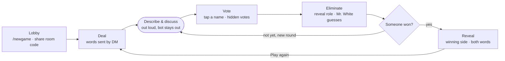

# M1 Telegram game master

Status: shipped 2026-10-13   ·   Serves: UC-1 – UC-6   ·   Roadmap: Shipped   ·   Implementation: [M1](../../implementations/M1-telegram-game-master.md)

## Problem

The legacy bot only dealt words, with thin rules, typed commands, no permissions and state
in a laptop's memory (see [strategy](../strategy.md#problem)). Someone had to run every
game by hand and never got to play properly. M1 makes the bot the whole game master on
Telegram, online 24/7.

## Decisions

| Topic | Decision |
| --- | --- |
| Rules | The *Undercover* variant: civilians and spies each get a word, the two words are similar, and **spies are not told they are spies**. A spy has to work out from other people's descriptions that they are off, which makes games longer and more fun. |
| Wordless role | The legacy "spy has no word" mode is dropped; the only wordless role is Mr. White (optional). |
| Chat model | No group chat. Every player chats privately with the bot and joins by code or invite link; shared announcements go to every player's DM. |
| Input | Every in-game action is an inline button, not a typed command. |
| Score | Count games won per player; no points by role. |
| Speaking order | From round 2, the previous order rotated by one (eliminated players removed), so a different person opens each round. |
| Leaving mid-game | Counts as eliminated and the role is revealed. Mr. White leaving instead of guessing counts as a wrong guess. |
| No votes | Nobody is eliminated and a new round starts. |
| Platform | Cloudflare Workers (free plan) + Durable Objects, webhook only; see `AGENTS.md`. |

## Flow of a game

## User stories

Each story is a GitHub issue with full acceptance criteria. Story IDs use one letter per
epic: `L` rooms, `R` dealing, `G` rounds, `E` end of game, `S` score.

| ID | Story | Acceptance criteria (summary) | Priority | Status |
| --- | --- | --- | --- | --- |
| **Rooms** | | | | |
| L1 | As a host, I type `/newgame` in a DM with the bot to open a room | 4-character room code and invite link `t.me/<bot>?start=<code>`; host joins automatically; one room per player at a time | Must | Done (#2) |
| L2 | As a player, I tap the invite link or type `/join <code>` to join | No room list to pick from; tapping again does not add me twice; correct display name (never "None"); the room is told "X joined" | Must | Done (#3) |
| L3 | As someone in a room, I see who is there | Each player has a lobby message in their DM, updated in place; a [Leave room] button; the host also has [Start] | Must | Done (#4) |
| L5 | As a latecomer, I go to a waiting list while a game is running | I get no word for the current game; I am dealt into the next one | Should | Done (#6) |
| **Dealing** | | | | |
| R1 | As a player, I get my word without the person next to me seeing it | DM "Your word: X", the same template for civilians and spies; Mr. White gets "You are Mr. White" | Must | Done (#7) |
| R2 | As a player, I can see my word again without scrolling | The game status message has a [Show my word] button that opens a popup | Should | Done (#8) |
| **Rounds** | | | | |
| G1 | As a player, I know who speaks first | At the start of each round the bot sends the whole room the speaking order (living players only); Mr. White is never first | Must | Done (#9) |
| G2 | As a host, I tap [Open vote] when the table has finished talking | Each living player gets name buttons in their DM; one vote, changeable until close; the host sees "Voted 5/7" without seeing who voted for whom; eliminated players get no buttons | Must | Done (#10) |
| G3 | As a player, I learn who was eliminated and what they were | The vote closes when everyone has voted or the host taps [Close]; the bot sends everyone the vote count per player, who is out and their role; ties follow the rules | Must | Done (#11) |
| G4 | As an eliminated Mr. White, I get to guess the word | The bot asks Mr. White by DM for one guess; case and extra spaces ignored; the room waits for the result | Should | Done (#12) |
| **End of game** | | | | |
| E1 | As a player, I see the result and the reveal | The bot sends everyone the winning side, every player's role and both words | Must | Done (#14) |
| E2 | As a host, I tap [Play again] | Same players and settings; a new word pair not played in this room in the last 24 hours; the waiting list joins | Must | Done (#15) |
| E3 | As a host, I end a game early with `/end` | Host only; the bot reveals everything and closes the game; no win counted | Must | Done (#16) |
| E4 | As a player, I am not stuck when the host leaves | Host rights pass to the earliest joiner still in the room; an empty room closes | Should | Done (#17) |
| **Score** | | | | |
| S1 | As a player, I see the room's scoreboard | `/score` shows games won per player in the room; no points by role | Could | Done (#18) |

L4 (host settings) moved to [M2](M2-host-settings.md); G5 (timers, #13) and S2 (long-term
stats, #19) are on the [roadmap](../roadmap.md) under Later.

## Success check

The MVP (every Must) shipped 2026-10-13 together with the Should stories L5, R2, G4, E4 and
the Could story S1. The North Star check is the next café session: a full session played
with the bot alone, nobody running the game by hand.

## Out of scope

- Host configuration (M2), timers, long-term stats.
- Remote play, group chats, a web client (M3).
